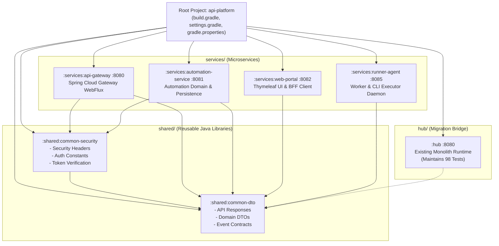
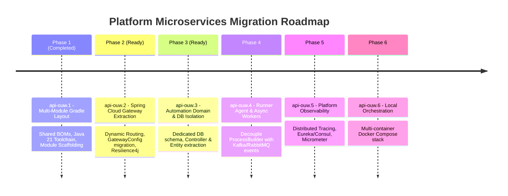

# Architectural Design Document: Multi-Module Gradle Layout Refactor

**Task ID**: `api-ouw.1`  
**Parent Epic**: `api-ouw` (Migrate Spring API Hub to a True Microservices Platform)  
**Status**: Completed / Ready for Review  
**Target Java Version**: Java 21 (LTS)  
**Gradle Toolchain Version**: Gradle 9.5.1  
**Framework Stack**: Spring Boot 4.1.0, Spring Cloud 2025.1.2  

---

## 1. Executive Summary

Prior to this phase, the repository was structured as a single monolith project rooted inside the `hub/` directory. All subdomains (Gateway routes, Jenkins automation execution, database persistence, and Thymeleaf web presentation) shared a monolithic runtime and classpath. Furthermore, no Gradle wrapper or build definition existed at the root of the workspace.

**Phase 1 (`api-ouw.1`)** transforms the repository into an enterprise-grade Gradle multi-module layout, establishing:
1. Root-level Gradle orchestration with unified build conventions and centralized BOM management.
2. Java 21 toolchain isolation and standard linting/testing configurations.
3. Decoupled module boundaries for services (`services/*`) and reusable libraries (`shared/*`).
4. Backward-compatible retention of the existing `:hub` application to ensure zero downtime and zero regression across the existing 98 unit and integration tests during progressive decomposition.

---

## 2. Target Architecture & Project Structure

### 2.1 Project Module Hierarchy



### 2.2 Filesystem Layout

```
microservices/spring/api/
├── gradle/                          # Shared Gradle wrapper binaries & distribution
│   └── wrapper/
│       ├── gradle-wrapper.jar
│       └── gradle-wrapper.properties (Gradle 9.5.1)
├── gradlew                          # Linux/macOS executable wrapper
├── gradlew.bat                      # Windows executable wrapper
├── gradle.properties                # JVM args & Java 21 Home configuration
├── settings.gradle                  # Subproject inclusions & root metadata
├── build.gradle                     # Global conventions, toolchain, & BOMs
├── compose.yaml                     # Root multi-container orchestration definition
│
├── shared/                          # Reusable library modules (java-library)
│   ├── common-dto/                  # Shared data transfer objects & event payloads
│   │   ├── build.gradle
│   │   └── src/{main,test}/java/
│   └── common-security/             # Auth constants, headers, filter utilities
│       ├── build.gradle
│       └── src/{main,test}/java/
│
├── services/                        # Standalone Spring Boot deployables
│   ├── api-gateway/                 # Edge gateway (Phase 2 target)
│   │   ├── build.gradle
│   │   └── src/main/{java,resources}/
│   ├── automation-service/          # Domain logic & automation DB (Phase 3 target)
│   │   ├── build.gradle
│   │   └── src/main/{java,resources}/
│   ├── web-portal/                  # Thymeleaf frontend application
│   │   ├── build.gradle
│   │   └── src/main/{java,resources}/
│   └── runner-agent/                # Host process/Docker execution worker (Phase 4 target)
│       ├── build.gradle
│       └── src/main/{java,resources}/
│
└── hub/                             # Legacy monolith (active throughout migration)
    ├── build.gradle
    ├── src/{main,test}/java/
    └── src/main/resources/
```

---

## 3. Build & Convention Strategy

### 3.1 Centralized Dependency Management

To prevent version skew across microservices, dependency versions are declared centrally in the root [build.gradle](file:///home/alpharius/dev/devlopment/java_dev/microservices/spring/api/build.gradle) via Spring Boot and Spring Cloud Bill of Materials (BOMs):

| Dependency Set | Version Coordinate | Scope |
| :--- | :--- | :--- |
| **Spring Boot Dependencies** | `org.springframework.boot:spring-boot-dependencies:4.1.0` | Global Subproject BOM |
| **Spring Cloud Dependencies** | `org.springframework.cloud:spring-cloud-dependencies:2025.1.2` | Global Subproject BOM |
| **Java Toolchain** | `JavaLanguageVersion.of(21)` | Global Subproject Standard |
| **Lombok** | `1.18.46` | Global Compilation & Annotation Processor |
| **JUnit 5 Platform** | Standard Spring Boot Test Managed | Global Test Framework |

### 3.2 Selective Subproject Configuration

Because Gradle recognizes intermediate directory nodes (`:services` and `:shared`) as projects, configuration logic uses the leaf filter `project.childProjects.isEmpty()`:
- Intermediate container directories (`:services`, `:shared`) remain pure organizational containers.
- Leaf subprojects automatically receive the Java plugin, dependency management BOMs, Lombok processors, and JUnit 5 test platform tasks.

### 3.3 Executable Services vs. Shared Libraries

```groovy
// Shared Libraries (e.g. shared/common-dto, shared/common-security)
plugins {
    id 'java-library'
}
// Outputs standard reusable JARs without repackaging into Spring Boot fat JARs

// Services (e.g. services/api-gateway, services/automation-service)
plugins {
    id 'org.springframework.boot'
}
// Automatically packages executable bootJar with Spring Boot launchers
```

---

## 4. Module Specifications & Responsibilities

### 4.1 Shared Modules

#### `shared:common-dto`
- **Purpose**: Common data structures shared across network boundaries (synchronous HTTP DTOs and asynchronous message broker events).
- **Initial Components**:
  - `ApiResponse<T>`: Standardized response envelope containing status flags, response data, error messages, and ISO-8601 timestamps.
  - `ProductDto`: Canonical data transfer representation of platform products.
- **Dependencies**: Jackson (`jackson-databind`, `jackson-annotations`), Apache Commons Lang.

#### `shared:common-security`
- **Purpose**: Unified security definitions, token header contracts, and common filter interfaces.
- **Initial Components**:
  - `SecurityConstants`: Well-known protocol constants (`Authorization`, `Bearer `, `X-Shutdown-Token`, `X-Drain-State`).

---

### 4.2 Service Modules

#### `services:api-gateway` (Port `8080`)
- **Purpose**: Dedicated edge reverse proxy, authentication verification, rate limiting, and request routing.
- **Stack**: Spring Cloud Gateway Server WebFlux, Spring Boot Actuator, Project Reactor.
- **Next Phase (`api-ouw.2`)**: Migrate existing `GatewayConfig` from `:hub`, configure dynamic routing (`/products/automation/**` to `automation-service`), and add Resilience4j circuit breakers.

#### `services:automation-service` (Port `8081`)
- **Purpose**: Autonomous domain service managing automation metadata, execution history, and Jenkins configurations.
- **Stack**: Spring Boot WebFlux, Spring Data JPA, HikariCP, MySQL Connector, Actuator.
- **Test Harness**: Configured with Testcontainers MySQL 8.4 integration.
- **Next Phase (`api-ouw.3`)**: Extract `AutomationEntity`, `AutomationRepository`, and `ProductAutomationController` out of `:hub` into this module.

#### `services:web-portal` (Port `8082`)
- **Purpose**: Customer-facing web portal rendering server-side Thymeleaf templates and consuming backend microservices via WebClient.
- **Stack**: Spring Boot Starter Thymeleaf, Spring Boot Starter WebFlux, WebClient.

#### `services:runner-agent` (Port `8085`)
- **Purpose**: Daemon worker executing Docker CLI invocations and host ProcessBuilder commands.
- **Next Phase (`api-ouw.4`)**: Consume execution action events off message brokers (Kafka/RabbitMQ) rather than executing directly inside web threads.

#### `:hub` (Legacy Transition Service)
- **Role**: Maintains operational continuity during migration. Contains existing endpoints, web filters, graceful shutdown coordinator, and legacy database access.
- **Verification**: All 98 existing unit and integration tests compile and execute cleanly within the new Gradle structure.

---

## 5. Quality Assurance & Verification Results

### 5.1 Quality Gates Executed

```bash
# 1. Project discovery and hierarchy validation
./gradlew projects

# 2. Complete compilation across all modules
./gradlew testClasses

# 3. Full test suite execution across all modules
./gradlew test

# 4. Packaging and artifact verification
./gradlew build -x test
```

### 5.2 Test Matrix Results

| Module | Build Status | Test Count | Test Pass Rate |
| :--- | :--- | :--- | :--- |
| `:hub` | `BUILD SUCCESSFUL` | 98 | 100% (98/98) |
| `:shared:common-dto` | `BUILD SUCCESSFUL` | 2 | 100% (2/2) |
| `:shared:common-security` | `BUILD SUCCESSFUL` | 1 | 100% (1/1) |
| `:services:api-gateway` | `BUILD SUCCESSFUL` | 1 | 100% (1/1) |
| `:services:automation-service` | `BUILD SUCCESSFUL` | 1 | 100% (1/1) |
| `:services:web-portal` | `BUILD SUCCESSFUL` | 1 | 100% (1/1) |
| `:services:runner-agent` | `BUILD SUCCESSFUL` | 1 | 100% (1/1) |
| **Total Project** | **`BUILD SUCCESSFUL`** | **105** | **100% (105/105)** |

> [!NOTE]
> During test baseline establishment, `HubApplicationTests.java` was updated with `@Import(HubIntegrationTest.Containers.class)` to prevent test failures when an external standalone MySQL server is not running locally.

---

## 6. Migration Roadmap & Next Steps



### Key Decisions for Review

1. **Gradle Wrapper Location**: Gradle wrapper files (`gradlew`, `gradlew.bat`, and `gradle/wrapper/*`) now reside at the repository root, allowing developers to execute standard `./gradlew <task>` commands from the repository root.
2. **Transition Strategy**: `:hub` is retained as an active subproject in the root `settings.gradle` so that existing APIs, admin controllers, and tests remain untouched until Phase 2 and Phase 3 incrementally decouple them.
3. **Java 21 Home Configuration**: [gradle.properties](file:///home/alpharius/dev/devlopment/java_dev/microservices/spring/api/gradle.properties) pins `org.gradle.java.home=/usr/lib/jvm/java-21-openjdk` to prevent system default JDK 27 from triggering Groovy AST compiler bytecode incompatibilities with Gradle 9.5.1.
